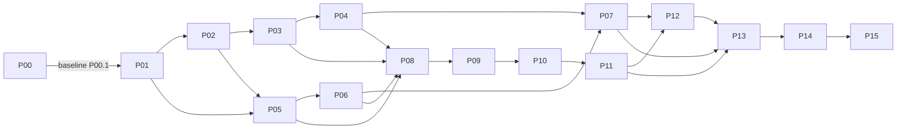

# Game Engine Implementation Plan

**Status:** planning only, 2026-11-24. Baseline: `f1cd5c6`. This replaces the older Phase 0-10 outline. Work packages are not single large pull requests: implement the numbered slices in each package independently and apply the [iteration playbook](iteration-playbook.md).

## Scope and completion

Deliver a server-authoritative, two-player game from room creation to an immutable result, implementing the supplied core book and at least two complete compatible factions. Include recruitment, base/figure geometry, all core terrain and deployment options, Orders/SAGA dice, complete supported battle boards, four activations, manoeuvres, fatigue, shooting/melee/withdrawal, equipment/Hero rules, optional battlefield chaos, scoring, reconnect, save/resume, and usable UI. [R01-R34](rules-coverage.md) are the coverage checklist.

A demo using invented abilities is a development milestone, not completion. Complete faction sources and resolution of release-relevant source questions are mandatory. Additional books/content are separate packs with their own acceptance lists. No undocumented rules shortcuts, manual state edits, or client-authoritative calculations are permitted in the completed game.

## Baseline audit and migration obligations

| Current evidence | Reuse | Required change |
| --- | --- | --- |
| `app/main.py`, `connections.py` | Room transport, presence, validation patterns, existing WS tests | Extract dispatch; stable seats; serial transactions; current active-player blanket check cannot gate reactions |
| `app/rules/types.py`, `registry.py`, `saga_core.py` | Module discovery and passive manifest | Executable runtime, capability/version contracts; classify metadata as provisional |
| `validate_unit_state` and `Unit` | Basic ID/type/owner shape | Separate recruitment from in-game validity; current minimum rejects surviving sub-four units; per-figure geometry |
| Default A/B tokens and ownerless Warlords | Sandbox fixtures | Real roster/deployment and ownership; no seeded demo figures in enforced games |
| 800 x 500 mm board, whole-mm tokens | SVG viewport and drag previews | Scenario-sized table and exact imperial measurement configuration; versioned fixed-point migration |
| d20 initiative, winner chooses order | Sandbox flow only | Clash d6 first player and explicit tie adaptation; no choice of first/second in that scenario |
| Connection-list turn rotation and disconnect auto-pass | Presence notifications | Fixed seat order; pause/rejoin without changing turn; keep games when sockets close |
| `ACTIVATE_TOKEN` counters | Sandbox markers | Activation grant/cost/resolution; separate counters for rest, repetition, consecutive shooting, cancelled actions |
| `ROLL_DICE` count <=20 | RNG service seed implementation | Structured rule rolls, ordinary/SAGA distinction; melee may roll 32 attack dice |
| Terrain manifest `adds_fatigue_on_entry`, generic cover/LOS booleans | Discovery API shape only | Finishing versus crossing; independent height/difficulty/cover/size and geometry queries |
| Manifest `melee-reaction`, `survival_points`, `slaughtering_points` | Existing IDs need compatibility handling | Core keyword is Melee for either role; Clash uses massacre scoring; verify/replace labels with schema migration |
| `make_event` increments seq for private/shared responses | Envelope concept | Durable domain event cursor and state version separate from transport sequencing |
| Token-only undo | Sandbox feature | Transaction-aware safe undo; disable bypass in enforced play |
| `test_integration_smoke.py` | Transport regression suite | Currently tests only a bootstrap turn cycle; add real setup-to-result suite |
| App/Board generated types plus local parsers | Protocol generation and board controls | Remove duplicated shapes incrementally; add runtime validation and browser tests |

No source, schema, or runtime behavior changes in this planning branch. Update `docs/protocol.md` and `docs/data-model.md` when implementing their actual changes, not as though these proposals are already live.

## Milestones and dependency order

| Milestone | Packages | Demonstration |
| --- | --- | --- |
| M0: Reliable substrate | P00-P03 | Versioned source/config, deterministic commands, stable seats, legal roster and exact figure geometry |
| M1: Setup and orders | P04-P07 | Legal terrain/deployment, pregame dice, both Orders reaction windows, persisted choices |
| M2: Full core actions | P08-P11 | Movement/rest, shooting, charges/melee/withdrawal, fatigue and all core equipment/special rules |
| M3: Complete supported game | P12-P13 | Real complete battle boards and all core scenario end/chaos/scoring paths |
| M4: Release-ready online play | P14-P15 | Durable recovery, full browser game, replay agreement, verified source questions/content |

Dependency graph (an arrow means prerequisite):

This is a safe default execution order, not a request for concurrent work. Source collection/verification for P12 begins in P00; do not wait until combat is finished to discover that faction sources are missing. P01 establishes a storage interface early; P14 supplies production durability. Every package includes narrow UI and snapshot support, so P15 is integration work rather than the first frontend implementation.

## P00 - Source baseline and decisions

**Depends on:** none. **Covers:** provenance for all requirements, especially R01/R33.

1. `P00.1`: Create the machine-readable source/requirement registry from [coverage](rules-coverage.md), pin source hash, and record selected digital conventions. Preserve open questions as unresolved; do not claim official FAQ verification.
2. `P00.2`: Apply recorded owner rulings Q01-Q05 without reopening them; investigate only new source gaps. Identify two mutually compatible factions and obtain complete lists/boards/corrections. Engine scaffolding may proceed while these source-specific items remain open.
3. `P00.3`: Add capability/source support status to module metadata design, confirm pack storage/validation format, and record the geometry/protocol/state decisions as ADRs when implementation begins.

**Touch:** `rules-roadmap/`, new source registry under rules data, `docs/adrs/`; metadata schema only if needed in that slice.

**Exit:** every planned rule has a source and owner package; unresolved questions explicitly gate affected conformance. Do not defer a basic-engine design decision to “decide later” when this plan already selects a default.

## P01 - Command runtime, identity, event ledger

**Depends on:** P00.1. **Covers:** R27-R30/R32 foundation.

1. `P01.1`: Extract dispatch from the WS loop, introduce deterministic reducer and in-memory event-store adapter; preserve sandbox regression behavior. Add explicit sandbox/enforced routing boundary.
2. `P01.2`: Stable seats and private resume credentials; separate presence/spectators; fixed seat order; enforced rooms pause on disconnect and survive empty connections.
3. `P01.3`: Per-room serialized transactions, typed schema validation, dedupe receipts, expected versions, domain event cursor, full snapshot/resync, injected RNG interface.
4. `P01.4`: Block legacy token/roll/undo commands from bypassing enforced rules; protocol-version handshake for changed identity/envelopes.

**Touch:** `app/main.py`, `connections.py`, new `app/engine/`, `app/commands/`, schema/generators, web connection/store, transport tests.

**Exit/tests:** duplicate accepted command has one result and one RNG consumption; malformed/unauthorized/stale intents cannot mutate; retry is recognized before stale-version check; concurrent clients cannot spend the same resource; rejoin preserves ownership/turn; private traffic cannot create false replay gaps. Existing sandbox tests pass. Full durability is still explicitly pending P14.

## P02 - Profiles, warbands, figures, and roster UI

**Depends on:** P01. **Covers:** R02-R03, R20/R24 model.

1. `P02.1`: Immutable profiles/equipment definitions; Hero class/Warlord role; separate physical/effective counts and melee/shooting stats. Preserve legacy manifest compatibility through versioning.
2. `P02.2`: Recruitment ledger, point bundles/single exchange, faction validation hooks, unit organization, individual figure/base state, stable owners; original size immutable.
3. `P02.3`: Roster editor/import validation and unit inspection. Ordinary surviving count permits 1..3; destroyed units retain ledger identity and cannot act.

**Touch:** rules/domain state and schema; new roster tests/components; default room fixture construction.

**Exit/tests:** no ownerless deployed units; valid and invalid budgets/groupings; exact one Warlord; profile versus equipment legality; subminimum survivors; cannot edit a locked roster or silently merge/split units. Synthetic packs remain test-only.

## P03 - Exact geometry and formation

**Depends on:** P02. **Covers:** R01/R04 and queries for R05/R14-R19.

1. `P03.1`: Fixed-point conversion, C-to-S distance normalization, and band/inch measurements, circular/nonround bases, within/entirely-within predicates, board bounds. Version coordinates once; render all measurements from the same config.
2. `P03.2`: Connected formation graph, reference validation, ordered placements, obstacles/inter-figure barriers, swept corridors and end rotation.
3. `P03.3`: LOS segment/terrain queries, deployment-region helpers, bounded deterministic contact/withdrawal feasibility approach with documented numerical tolerance and adversarial tests.
4. `P03.4`: Board renders individual bases and selection/group previews; add read-only ruler/range/formation diagnostics and non-drag placement inputs.

**Touch:** new `app/geometry/`, policy adapters in rules, `Board.tsx`, geometry fixtures/tests.

**Exit/tests:** threshold equality/one quantum either side for exact imperial bands and inch distances; rotations cannot create movement; no path tunneling; disjoint clusters fail; source/target edge sight; deterministic placements. P03.3 must demonstrate feasibility checking, not label a heuristic failure “impossible.” No aggregate-unit-footprint shortcut for enforced play.

## P04 - Terrain engine and catalog

**Depends on:** P03. **Covers:** R05, terrain portion R06.

1. `P04.1`: Independent traits and curated footprints; all seven Clash presets; impassable primitives; size/count restrictions using the owner-confirmed S minimum small-terrain width (Q01).
2. `P04.2`: Path-wide unit restrictions, partial/full containment, high-terrain sight queries, terrain fatigue hooks and horse-specific contribution.
3. `P04.3`: Terrain placement preview, authoritative rejection reasons, trait/cover overlay, setup locks.

**Touch:** rules terrain policies/catalog, geometry tests, schema, board terrain UI.

**Exit/tests:** crossing versus finishing; one figure slows whole unit; no cover from partial containment; hill blocks through-sight without slowing; rocky ground slows/protects without height; large-only/count rules; dangerous and uneven remain distinct traits.

## P05 - Resolutions, choices, and ability primitives

**Depends on:** P01-P02. **Covers:** R08/R10-R12/R31 infrastructure.

1. `P05.1`: Serializable resolution stack, choice lifecycle, actor/role permissions, parent resumption, two-pass alternating window, empty-window progression.
2. `P05.2`: Typed ability costs, trigger IDs, restrictions, effect order/dependencies, captured/deferred values, durations, explicit overrides; deterministic RNG continuations.
3. `P05.3`: Generic pending-choice/priority panel, effect ordering UI, read-only opponent state, resync during nested choice.

**Touch:** engine resolutions, rules effects/timings, schema, choice UI, unit/integration tests.

**Exit/tests:** nonactive player can respond only to owned choice; duplicate/stale/wrong-trigger responses fail; pass/act/pass/pass works; one Activation/Reaction per occurrence; effects use correct priority and duration; no callback/closure in snapshot. Core runtime does not inspect faction names.

## P06 - Turn and Orders/SAGA dice

**Depends on:** P05 and P02. **Covers:** R08-R10, R01 dice arithmetic.

1. `P06.1`: Turn IDs/counters and explicit Orders substates, generation query, exactly-eight inventory, retained allocation reclaim, initial symbol roll.
2. `P06.2`: Allocation cost groups, Orders effects/extra rolls, two opponent reaction windows, basic/advanced placement and trigger limits.
3. `P06.3`: End-Orders cleanup, retained allocations, turn expiry/reset, board/dice tray and phase controls. Expose scenario turn-start/end hooks; P13 supplies complete termination.

**Touch:** rules turns/dice/abilities, schema/events, board panel/phase UI.

**Exit/tests:** threshold changes after casualties; no ninth die; reclaim all of multi-cost; carry-over/reallocate/trigger counters; independent ordinary/SAGA rerolls; active effects and fatigue survive appropriate boundaries; cannot activate during Orders.

## P07 - Complete setup flow

**Depends on:** P04 and P06. **Covers:** R03/R06-R07, R26 setup.

1. `P07.1`: Game configuration and both-player option agreement, roster organization freeze, correct table/edges, Clash first-player procedure with named digital tie rule.
2. `P07.2`: Alternating terrain placement, legal reposition after three, opponent final offer, immutable terrain lock.
3. `P07.3`: Deployment die/adjustment and A/B/C zones; first half including Warlord, all second player, first remainder; every figure validated.
4. `P07.4`: Second-player three-die pregame allocation, chaos setup hooks, readiness/start barrier. Provide full setup wizard and step back only before its committed/revealed boundary.

**Touch:** scenario setup module, state/schema, setup wizard, geometry/integration tests.

**Exit/tests:** both edge orientations for each method; odd quota; no out-of-zone base sliver; no missing figure; no pregame ability triggering; wrong setup actor rejected. Start enters actual Orders, not today's demo running phase.

## P08 - Movement, rest, manoeuvre, fatigue

**Depends on:** P03-P06. **Covers:** R12-R14; charge declaration skeleton R15.

1. `P08.1`: Validated activation grants, separate all-action/MCS/last-kind histories, cancellation, multi-unit queue, opponent pre-action fatigue windows.
2. `P08.2`: Movement proposals and atomic route/formation commit; terrain/fatigue interactions; manoeuvre; preview/confirm/cancel UI.
3. `P08.3`: Rest, exhaustion/cap, repetition timing, nearby destruction fatigue handler, no-fatigue versus free semantics; fatigue and activation status UI.

**Touch:** activations/fatigue/movement rule handlers, schema, board actions/choice panel.

**Exit/tests:** all R12-R14 cases; rest then move; cancelled grants; two-fatigue cancellation including rest; optional fatigue reduction to S; enemy-turn histories; manoeuvre throughout path; repeat+terrain stacking. Do not expose charge as complete until P10 or shoot until P09.

## P09 - Shooting vertical slice

**Depends on:** P08 (and P03-P06). **Covers:** R16-R17/R20, ranged parts R22.

1. `P09.1`: Weapon/range/LOS eligibility, single target, reaction revalidation, unitless source shape; show per-figure eligibility.
2. `P09.2`: Initial/bonus pool caps, ability/fatigue window, ordered attack/defence RNG/effects, automatic hits, cover and Armour.
3. `P09.3`: Prevention extension hooks, owned casualty choices/cohesion, loss/destruction ledger, post-shoot fatigue and complete combat summary. Special prevention implementations arrive P11.

**Touch:** shooting resolver, dice/effects/casualties, UI target/combat/casualty controls, focused WS tests.

**Exit/tests:** scripted dice make expected losses; stage caps and fractional aggression; no sight after reaction cancels without refund; choose out-of-range casualty; no client-defined hit totals; reconnect in every step; unitless restrictions. A deterministic fixture battle can finish a shot with no manual intervention.

## P10 - Charge, melee, withdrawal vertical slice

**Depends on:** P09 (reuses pool/loss infrastructure). **Covers:** R15/R18-R20.

1. `P10.1`: Charge placement/contact solver, fixed reference, mandatory approach, reaction revalidation and cancellation rollback; apply repetition/terrain fatigue before melee.
2. `P10.2`: Close ranks, both pools, alternating effects/fatigue, latched exhaustion, simultaneous attack/defence handling, ordered casualty selection and contact preservation.
3. `P10.3`: Outcome calculation, end fatigue, withdrawal obligation and validated blocked-route fallback; complete placement UI and resume at every choice.

**Touch:** charge/melee/withdrawal policies, geometry solver, ledger, UI, regression fixtures.

**Exit/tests:** each R15/R18/R19 case, including failed last figure, 32 dice, early destruction versus contact break, odd closed-ranks pool, mutual annihilation, protected defender forcing retreat, blocked withdrawal and alternate separation. No completed melee leaves units illegally touching.

## P11 - All core special rules and equipment composition

**Depends on:** P10. **Covers:** R21-R24; completes prevention and profile exceptions.

1. `P11.1`: Determination, We Obey, Presence, Pride; individual counters and explicit count query policies.
2. `P11.2`: Resilience, Bodyguards, Heroic Unit with prevention/redirection/swap choices; apply resolved Q02/Q04, including exchanges reaching exhaustion and Presence limited to SAGA abilities.
3. `P11.3`: Every R22/R23 equipment behavior; consecutive-shot history, horse penalties/overrides, javelin grant. Apply resolved Q05: charge-only timing; Improvised Projectiles permits close ranks unless another restriction forbids it.
4. `P11.4`: Core mercenary/Legendary restrictions and support flags, composition tests against terrain, fatigue, scoring, and abilities; source-less profiles remain test-only.

**Touch:** rule primitives/definitions, roster validation, choice UI, cross-rule regression tests.

**Exit/tests:** all listed rules work, not just manifests; prevention does not truncate incoming Hero casualties; Bodyguards cannot bounce; cancellation consumes free uses; mounted/weapon combinations validated; mercenary fatigue exception remains usable. No generic transport branch named after a special rule.

## P12 - Two complete faction packs

**Depends on:** P07/P11; source collection starts P00. **Covers:** R03/R10/R24/R33.

1. `P12.1`: Import only complete, compatible, source-verified lists/boards; pin revisions/hash and declare needed capabilities. Fail with useful missing-content messages if absent.
2. `P12.2`: For every ability record source, costs, timing, restrictions, use limits, ordered effects, choices, duration, overrides, and interaction tests. Implement any missing primitive with focused tests before enabling that ability.
3. `P12.3`: All supported recruitment/equipment choices and dice-symbol mappings; complete original ability-panel UI; pack lint and two-faction conformance fixtures.

**Touch:** data packs, narrow rule handlers, manifest/schema as necessary, content tests and ability/roster UI.

**Exit:** two entire boards and army lists playable. Every selectable item maps to implementation/tests; no disabled-but-selectable abilities, placeholder text effects, or inferred costs from the sample illustrations. Named mercenary/Legendary choices ship only with their own complete verified profiles. Resolve every capability declared by either pack.

## P13 - Scenario completion, scoring, chaos

**Depends on:** P07/P11/P12. **Covers:** R25-R26/R34.

1. `P13.1`: Turn-start zero-generation loss and end after six turns each; score ledger calculation, ordinary/mercenary/Legendary bonuses, threshold/draw logic, concession.
2. `P13.2`: All six chaos outcomes, pregame/turn-duration effects and score interactions, mutual opt-in recorded in configuration.
3. `P13.3`: Immutable final result, per-category explanation, final board/history and rematch as a new game; reject gameplay after finish.

**Touch:** Clash scenario/scoring, turn hooks, UI results/options, scenario tests.

**Exit/tests:** boundary scores 7-0/8-7/8-6; sixth turn of second player completes; final effects before score; zero generated differs from no available dice; Warlord death alone does not finish; Judgement/Slaughter correctly included; simultaneous losses and redirected casualties score once.

## P14 - Durable save/resume, replay, safe undo

**Depends on:** P13; uses P01 contracts. **Covers:** R27-R30/R32/R34.

1. `P14.1`: Postgres event/snapshot/receipt store and migrations; atomically commit game changes; configurable retention independent of sockets; preserve pinned pack versions.
2. `P14.2`: Client reconnect/backoff, stable resume, full resync/gap recovery; pause while opponent disconnected; handle server restart mid-choice and commit-before-broadcast failure.
3. `P14.3`: Replay/export without credentials, deterministic hash checks, read-only spectators; safe deterministic negotiated undo or explicitly disabled committed undo in enforced play until its guarantees pass.

**Touch:** storage adapter/migrations/config, WS/client store, recovery/replay tests, operational docs.

**Exit/tests:** recover in every representative combat/setup/Orders checkpoint; expired/forged resume fails; duplicates across restart preserve rolls; process restart loses no committed game; old content cannot silently substitute; replay equals live final state. A restore-from-backup smoke check proves the configured durable path.

## P15 - Complete-game release verification

**Depends on:** P14 and all source/content gates. **Covers:** R01-R34 integration.

1. `P15.1`: Browser acceptance coverage for both seats: roster/setup, dice/abilities, movement/combat/choices, result, refresh/reconnect. Every required action has a usable non-console control.
2. `P15.2`: Run [release scripts](validation-and-release.md) using real supported factions, all deployment methods, equipment/special-rule cases, each chaos result, score/draw/automatic loss/concession, and interrupted play.
3. `P15.3`: Reconcile coverage registry, source rulings, feature support flags, protocol/model/context docs, and troubleshooting; remove internal-only test data from selectable content. Re-run required CI checks after final fixes.

**Exit:** every release checklist item is satisfied with evidence. Fixture-only, backend-only, manual-score, missing-faction, or unrecoverable games do not meet this milestone. Expansion work starts with a new source/coverage plan rather than expanding this release without updating its criteria.

## Status tracking

At planning time P00-P15 are not complete. Existing passive modules/units only reduce some scaffolding work. For each slice record status, prerequisite versions, changed paths, requirement/test links, manual demonstration, unresolved decisions, and exact next slice. Mark a package complete only when all its exit criteria pass. Use `source_blocked` for the affected behavior without blocking independent engine tasks.
