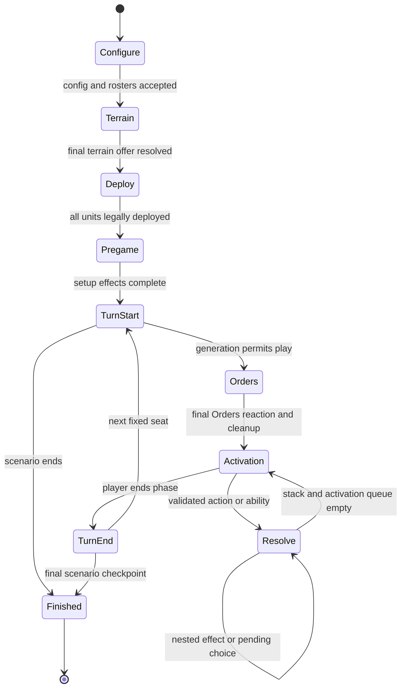

# Target Engine Design

**Proposed design, not current API behavior.** Read [coverage](rules-coverage.md) for mechanics and [decisions](decisions-and-source-gaps.md) for assumptions. Current contracts remain in `docs/protocol.md`, `docs/data-model.md`, and `schemas/protocol.json` until an implementation slice changes them.

## Boundaries and file ownership

| Area | Responsibility | Proposed location |
| --- | --- | --- |
| Transport/application | HTTP/WS authentication, room lookup, command parsing, dispatch, projection/broadcast | Keep `app/main.py` thin; extract `app/commands/`, retain `app/connections.py` |
| Generic engine | Serialized transactions, reducer, event store, RNG requests, pending-choice protocol, seat identity | New `services/api/app/engine/` |
| Generic geometry | Distances, footprints, intersections, swept corridors, spatial index | New `services/api/app/geometry/` |
| SAGA rules | Phases, profiles, formation policies, dice/abilities, fatigue, combat, scenario/scoring | Extend `services/api/app/rules/`; split `saga_core.py` into a package only in a focused migration |
| Content packs | Versioned definitions, provenance, capabilities, faction/ability/profile data | `services/api/app/rules/packs/` or a dedicated data directory selected in P00 |
| Schema | Shared envelopes and typed state/command/event/choice definitions | `schemas/protocol.json` and existing generators |
| Web projections | Snapshot/event application, reconnect/resync, action/choice rendering | Extract from `apps/web/src/ui/App.tsx` into protocol/store/feature components |
| Board | Selection, base rendering, terrain, previews, measurement, highlights | Evolve `apps/web/src/ui/Board.tsx` behind focused geometry/view interfaces |

Core must not branch on names such as Warlord, Woods, or Javelins. It supplies primitives and invokes the rules runtime. No rule mutates a websocket, database session, global `ROOMS`, or client state. Definitions are immutable and versioned; live state is separate.

## Runtime contract

The current `RulesModuleProvider` only supplies metadata. Evolve it without pretending it already validates rules:

- `manifest()` exposes version, profiles, capabilities, and UI labels.
- `validate_configuration(config, packs)` checks compatible sources, supported capabilities, scenario, roster options, and imperial measurement configuration.
- `initial_state(config, seats)` produces a setup state, not two ownerless demo tokens.
- `decide(state, command, actor)` returns typed rejection or a bounded resolution plan: facts, RNG requests, and/or choices.
- `reduce(state, event)` applies facts deterministically. It does not consult wall clock, sockets, random sources, or a changed pack.
- `legal_actions(state, viewer)` returns permitted intents/reasons and current choice ownership. This is guidance; `decide` always revalidates.
- `project(state, viewer)` provides a complete permitted snapshot. Private resume credentials and unrevealed setup drafts are never included in opponent views.

An ability pack is declarative, schema-validated data plus registered, reviewed effect handlers where necessary. Never evaluate Python/JavaScript supplied by an imported pack. Unknown effects, recursive cycles, incompatible versions, or missing referenced definitions fail configuration, not mid-combat.

## State model

Names below are proposed domain concepts. Keep protocol DTOs separate from internal objects, and do not hand-edit generated files.

| Entity | Minimum information and invariants |
| --- | --- |
| GameConfig | Rules/pack/scenario IDs, versions and hashes, schema version, imperial measurement configuration, budget, allowed options, digital adaptations, agreed base profiles, immutable after setup lock |
| Seat | Stable seat/player ID, role, warband ID, connection status; credentials stored privately, multiple connections cannot create extra turns |
| GameState | Status (`setup`, `playing`, `paused`, `finished`), resumable prior status, state version, persistent event cursor, board, seats, phase state, terrain, warbands, resolutions, result |
| TurnState | Fixed seat order, round, global player-turn ID, active seat, turns completed per seat, Orders/Activation substate, expiry checkpoints |
| Warband | Owner seat, faction, recruitment ledger, original figures, units, dice inventory, battle-board allocations, option approvals |
| Unit | Stable ID, troop class/profile, owner, figure IDs, equipment/keywords, fatigue, initial count, status, histories scoped by player-turn ID; alive count derived |
| Figure | ID, original unit/profile/class, base shape/dimensions, position/orientation, alive/deployed state; decorative artwork never affects geometry |
| Terrain | ID, sourced preset, transformed footprint, height, difficulty, cover, size class, locked/setup status; effects preserve provenance |
| SagaDie | ID, owner, current symbol, location (`available`, `inactive`, `allocated`), allocation ID; inventory exactly eight |
| AbilityDefinition | ID, source, cost alternatives, basic/advanced classification, keywords, actor/target restrictions, effect steps, explicit overrides, capability dependencies |
| Allocation | ID, ability ID, exact dice IDs/symbols, placement turn; full cost group is atomic |
| AbilityUsage | Placement and trigger counters per ability per player turn; free-rule/equipment uses tracked independently |
| EffectInstance | Source, targets, captured values, evaluation timing, permitted overrides, ordered steps, expiry, owning player; no executable closures in saved state |
| Activation | ID, source/grant, unit, chosen kind/target, cancellation/resolution status, resolved action counters, no-repeat-fatigue flag, pre-move snapshot |
| Resolution | ID, kind, actor roles, parent ID, stage, queued continuations, committed parameters; one serializable stack per game |
| Choice | ID, resolution/trigger ID, version, owning seat, kind, legal options/constraints, response state, optional configured deadline |
| Combat | Attacker/defender, source activation, stage, start-exhaustion flags, initial pools, bonus pools, dice/effects, casualties by stage, outcome/withdrawal |
| Roll | ID, purpose, resolution, die IDs, count/sides/symbol mapping, raw values, ordered modifiers/rerolls with player attribution, final values |
| CasualtyLedger | Original identity, source/cause, step, prevented/redirected/actual losses, pre-removal footprint, destruction IDs |
| ScenarioState | Setup substep/actor, terrain sequence, deployment method/zones/quota, chaos, objectives, score breakdowns, terminal reason |
| GameResult | Winner/draw, reason, final turns, scoring facts, rules/content hashes, final event cursor/state hash; immutable |

Use physical count, SAGA-ability-effective count (Presence), aggression sum, initial count, and scoring count as distinct queries. Presence is never used for special rules or non-ability counts. Avoid a universal `unit.size` helper. Recruitment validation cannot be reused to reject reduced surviving units.

## State machines

Pause is an orthogonal status preserving the exact phase, resolution stack, RNG history, and choices. Reconnection resumes that state, never converts it to a new turn. In Orders, represent reclaim -> roll -> opponent reaction -> allocate/trigger -> final opponent reaction -> inactive cleanup explicitly. In setup, record each terrain/deployment actor and quota rather than a single `ready` boolean.

At player-turn start, run source-defined scenario checks before allowing a new action. At turn end, finish queued effects before scoring/advance. Expiry must distinguish end of this player turn, end of owner's next turn, end of activation, and end of combat. A simple decrement on active-player change is insufficient.

## Serialized command transactions

For each game, one logical writer executes:

1. Authenticate seat and parse the schema. Reject malformed types, booleans passed as integers, out-of-bounds payload sizes, and unknown fields/commands.
2. Look up `(game_id, seat_id, client_msg_id)`. Same ID and same payload returns the original receipt; same ID with different payload is an error. Do this before stale-version rejection for a genuine retry.
3. Under the room's lock/transaction, check `expected_state_version`, permissions, pending choice ID/version, rules/content versions, and phase legality.
4. Resolve against a working state. Commit accepted declaration/costs and explicit reaction choices at their proper checkpoints; do not keep an in-memory call stack waiting for the opponent.
5. Obtain randomness through the server RNG service only when the rules demand it. Append raw values as facts; client cannot supply pools, results, final hits, or winners.
6. Validate invariants and atomically commit ordered domain events, new state/snapshot checkpoint, and dedupe receipt. A rejected intent changes neither rules state nor dice history.
7. Broadcast committed results. A failed websocket send cannot undo a committed turn or permit a retry to reroll.

Use an in-memory event-store implementation for early slices with the same transaction contract as the later durable store. Keep one server process/writer per room initially; do not add Redis/distributed writes before there is a deployment need.

Today's `seq` advances on private HELLO/error traffic as well as shared broadcasts. Define a durable domain-event cursor distinct from transport sequencing in the new protocol. Clients detect gaps in the domain stream, not gaps caused by someone else's private response. `state_version` changes only on committed gameplay mutations; PING/presence/private errors cannot stale every action. Snapshot includes its cursor/version so applying later events is unambiguous.

## Randomness and replay

Use injectable randomness: production draws from the server's cryptographic source; tests use scripted rolls. Do not expose future seeds. Every roll has a purpose, source resolution, actor roles, raw outcomes, per-die identity, ordered transformations, and final values. Ordinary rolls and SAGA symbol dice are distinct families. Do not inherit the generic 20-die chat roller cap for melee.

Replay folds recorded events through a version-pinned reducer. It never calls `decide` again, rerolls dice, reruns path search, consults current content, or recomputes past choices from current conditions. Persist resolved geometry and choices as facts. Persisted hashes make a changed pack detectable. Preserve old pack/reducer versions for saved games or provide an explicit migration; never silently upgrade a live game.

## Choice and reaction protocol

A choice identifies its resolution, trigger occurrence, owning seat, response type, legal options/constraints, and state version. Replies contain only selected IDs/values, not a claimed outcome. Distinguish:

- One-shot defender decisions: close ranks only in melee after a charge (never in shooting), allowing Improvised Projectiles unless another restriction applies; casualty selections, prevention, deployment adjustment.
- Alternating windows: combat ability/fatigue/pass with priority and consecutive-pass count.
- Opponent windows: two Orders reactions and ability-specific Activation reactions.
- Ordered effects: player chooses ordering for their simultaneous effects, then next player acts.
- Compulsory placements: charge, casualty-preserving swap, withdrawal/fallback.
- Multi-unit activation continuations: targets already chosen, next action not yet chosen where rules allow it.

Automatically skip only a provably empty window, with the transition recorded. Otherwise require explicit pass/response. Casual play has no automatic response deadline; disconnect pauses. Optional timed modes are follow-on features with explicit pregame policy, never an implicit pass or forfeit. A bounded stack/step budget detects malformed effect cycles; exceeding it yields a recoverable engine fault, not an invented combat result.

## Geometry and measurement

Use integer fixed-point tenths of a millimeter internally and in the proposed enforced protocol (`x_q`, `y_q`, lengths in `q`; 10 q = 1 mm). VS/S/M/L = 508/1016/1524/3048 q, exactly 2/4/6/12 inches. Player-facing distances use bands first and inches otherwise; table is 48 x 36 inches and ruler width is 1 inch. No metric rules mode is planned. Normalize distance label C to S without changing other uses of C. Whole-mm legacy tokens map by multiplication by ten. Keep range expressions and exact conversions in rule data; never store rounded ruler lengths.

Generic queries must include:

- Minimum and maximum footprint distance, inclusive/strict comparisons, containment and boundary contact.
- Connected-component and valid-reference-figure checks.
- Circle and oriented nonround footprint intersection, swept translation corridors and permitted final rotation.
- Unit-gap blocking regions, with caller-supplied rule policy (movement and sight differ).
- Terrain intersections over the whole path; high-boundary crossing count with tangent cases specified.
- Existence of a clear source-base to target-base sight segment; not merely a center ray.
- Deployment half-planes/strips, scenario bounds, terrain separation and supported-shape width.

Document one numerical tolerance/error bound in the geometry ADR. Exact integer/rational comparisons should decide distance thresholds where feasible; do not scatter epsilons or enlarge legality by a client pixel. Approximation for oval footprints must have a documented error bound and boundary fixtures. No persistent state may depend on canvas zoom or viewport size.

A movement proposal carries ordered figure IDs, ruler segments/waypoints, and final poses. Validate the full formation atomically. A preview is local/read-only; it cannot reserve the outcome across an opponent reaction. Compute final legality after reactions.

Charge/withdrawal are constrained placements, not arbitrary endpoints. Given the selected figure order, solve/validate legal contact candidates before allowing a noncontact approach, then maximize permitted approach under movement/cohesion constraints. For withdrawal, validate the full-S route and obstacle justification before accepting a shorter alternative; try the opposing minimum-separation fallback only when required. P03/P10 must demonstrate a deterministic feasibility approach on adversarial layouts. A heuristic unable to find a route is not proof that none exists. If the implementation cannot establish the obligation, return a placement problem for correction and keep the resolution pending; do not claim full rules support until these cases have a validated solver. Persist chosen placements, so replay does not rerun optimization.

Start with curated valid terrain shapes and supported base shapes, then expand the editor after the geometry tests pass. Do not simplify enforced play to one unit token; allow group-drag UI that produces individual figure routes and supports corrections.

## Abilities and equipment

Resilience is an atomic casualty-prevention exchange: validate receiving fatigue below cap, choose 1..X pending casualties, cancel them and add exactly one fatigue, then recheck before offering another exchange. Reaching the cap is allowed; exceeding it or trading while already exhausted is not. Keep this precondition distinct from ordinary fatigue gains that are ignored at the cap.

Build small typed primitives driven by sourced requirements: grant activation, roll/reclaim/allocate/spend symbols, add attack/defence dice, modify Armour or results, request rerolls, add/remove fatigue, produce hits/casualties, prevent/redirect casualties, move figures, cancel activation, set duration/condition, open choice, and score/objective update.

Store evaluation timing and dependency links. Example: a captured current Armour-derived bonus does not change if Armour changes later. An effect conditional on paying fatigue differs from an independent fatigue removal followed by a bonus. Free activation, fatigue-exempt activation, and movement without activation are different primitives.

Use explicit exception identifiers for rules overridden by an ability. Do not let arbitrary data bypass every validator. The prohibition/override ordering must be tested against combinations such as mounted cover, mercenary advanced abilities versus fatigue, dangerous versus uneven immunity, and cancelled once-per-turn grants.

## Proposed command/event families

These names are design vocabulary; add final concrete payloads to the schema one slice at a time. Every state-changing intent carries dedupe ID and expected version; choice replies also carry choice ID/version.

| Intent family | Minimum intent | Authoritative facts/projection |
| --- | --- | --- |
| Configure/ready | Pack/scenario IDs, options, roster purchases/groupings, readiness | Configuration/roster accepted, ownership assigned, setup stage changed |
| Setup | Terrain preset/pose, reposition/final-placement response, deployment roll adjustment/diagonal, figure poses | Terrain placed/moved/locked, deployment method/zones/units, pregame effects |
| Orders | Reclaim allocation IDs, initial roll intent, allocation dice IDs/ability, trigger intent, end-phase intent | Dice rolled/allocated/returned, ability triggered, effects/choices, phase changed |
| Activation | Grant/ability ID, unit(s), action/target as appropriate | Activation declared, reaction opened, action resolved/cancelled, fatigue/history changed |
| Movement/placement | Resolution ID and ordered per-figure paths/poses | Authoritative poses or typed rejection with relevant figure IDs |
| Combat choices | Choice ID with ability/fatigue/pass, close ranks, effect order, reroll selection, prevention/casualties | Pools, rolls, hits, losses, combat outcome, withdrawal |
| Turn/end | End turn, concede | End effects, next seat/turn or immutable game result |
| Recovery | Resume credential and last domain cursor | Full authorized snapshot plus event continuation or explicit resync |
| Non-gameplay | Measure/preview, ping, sandbox rolls | Informational responses; cannot mutate enforced rules state |

Typed error codes should cover stale version, wrong actor/phase, expired choice, invalid target/path/formation/cost, insufficient dice, unsupported content, incompatible version, and terminal game. Include relevant IDs and concise explanations without leaking private data.

## Migration, UI, undo, and recovery

Introduce explicit `sandbox` versus `enforced` game mode. Keep the current bootstrap path available during migration; real SAGA rooms use the new runtime. Do not let `MOVE_TOKEN`, `ACTIVATE_TOKEN`, `ROLL_DICE`, or old undo bypass enforced costs, geometry, or combat. Retain generic rolls only as clearly informational where permitted. Version breaking coordinate/identity/snapshot changes and reject incompatible clients cleanly.

Each gameplay slice must include the minimal UI to exercise it: setup wizard/roster builder, figure/terrain board, unit stats and fatigue, categorized ability panel with symbol slots, active phase, opponent priority, pending decisions, target/range/cover previews, combat breakdown, and final score. Original panels may use canonical labels; reproducing the published board layout is unnecessary. Pending options remain visible across reload; non-owning client explains whose decision is awaited. Add keyboard and non-drag controls for critical actions and distinguish figures/owners without color alone.

Preview cancellation is local. For enforced play, restrict negotiated undo to a completed deterministic action checkpoint with no RNG disclosure, opponent choice, reaction, or downstream effect since it. Record a compensating event and restore the complete rules transaction, not just a token pose. Disable committed gameplay undo until this guarantee is implemented; sandbox can retain today's behavior. No reroll/refund by undo.

Use Postgres for durable events/snapshots/command receipts in P14, matching the repository's stated direction; no Redis is required for the first release. Pause on seat disconnect, retain games when sockets disappear, and resume stable seats through private credentials. Persist every committed choice checkpoint. Restart between commit and broadcast must return the same events on retry. Export replayable domain facts and pinned content references without credentials. Accounts, matchmaking, ranked clocks, and public spectator discovery can follow later.
